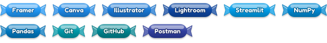
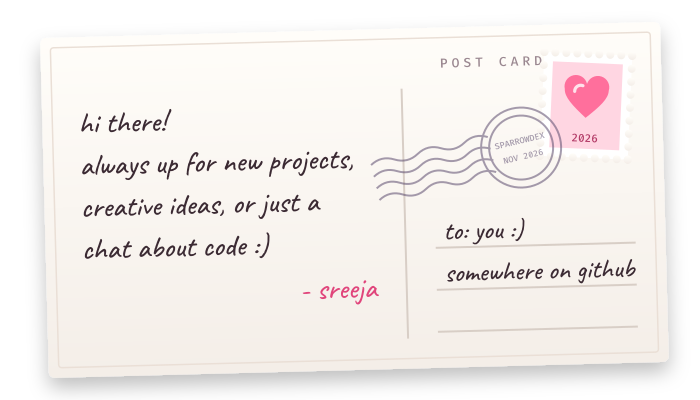

  

  

  <code>building</code>&nbsp; The Diecast Store 
  <code>learning</code>&nbsp; welding software (for an assignment, don't ask) 
  <code>let's talk</code>&nbsp; coding journeys &amp; what inspires you to create

  

 

<h3>
  <picture>
    <source media="(prefers-color-scheme: dark)" srcset="./images/titles/stack.svg">
    
  </picture>
</h3>

  
  &nbsp;
  
  &nbsp;
  
  &nbsp;
  
  &nbsp;
  

 

<b>🍬 Other Skills & Technologies</b>

 

<b>Frontend & Creative</b>

<b>Backend, Languages & Database</b>

<b>Design, Data & Tools</b>

 

<h3>
  <picture>
    <source media="(prefers-color-scheme: dark)" srcset="./images/titles/projects.svg">
    
  </picture>
</h3>

<table align="center">
  <tr>
    <td align="center" valign="top" width="50%">
      
       
      <em>A full-stack storefront with secure payments, live cart state, product filtering and an admin operations dashboard.</em>
        
      <a href="https://www.thediecaststore.in"><b>🔗 Visit store</b></a>
    </td>
    <td align="center" valign="top" width="50%">
      
       
      <em>An interactive 3D snow globe through Christmas Past, Present &amp; Future. Blow on your mic to make the snow dance.</em>
        
      <a href="https://ghostsofchristmas.vercel.app"><b>🔗 Shake it</b></a> &nbsp;·&nbsp; <a href="https://github.com/sparrowdex/Merry-Christmas"><b>💻 Code</b></a>
    </td>
  </tr>
</table>

 

<h3>
  <picture>
    <source media="(prefers-color-scheme: dark)" srcset="./images/titles/streaks.svg">
    
  </picture>
</h3>

  

    

  <picture>
    <source media="(prefers-color-scheme: dark)" srcset="https://raw.githubusercontent.com/sparrowdex/sparrowdex/output/github-contribution-grid-snake-dark.svg">
    <source media="(prefers-color-scheme: light)" srcset="https://raw.githubusercontent.com/sparrowdex/sparrowdex/output/github-contribution-grid-snake.svg">
    
  </picture>

 

<h3>
  <picture>
    <source media="(prefers-color-scheme: dark)" srcset="./images/titles/contact.svg">
    
  </picture>
</h3>

  

  
  
  

